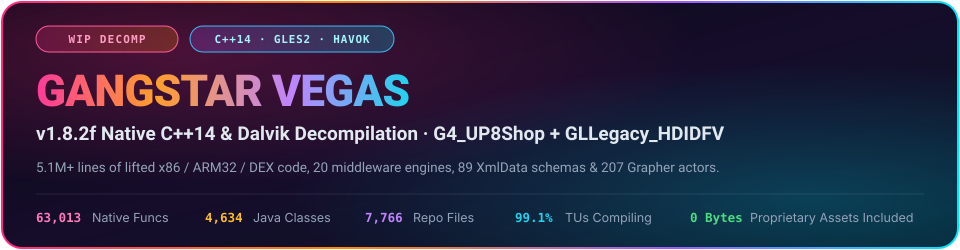

<div align="center">

<a href="https://jaiden051.github.io/gangstar-vegas-decomp/progress.html">
  
</a>

<br/>

[](https://jaiden051.github.io/gangstar-vegas-decomp/progress.html)
[](https://jaiden051.github.io/gangstar-vegas-decomp/progress.html)
[](https://jaiden051.github.io/gangstar-vegas-decomp/progress.html)
[](https://jaiden051.github.io/gangstar-vegas-decomp/progress.html)
[](#assets--binaries)

</div>

---

## Status

<div align="center">
  <a href="https://jaiden051.github.io/gangstar-vegas-decomp/progress.html">
    
  </a>
</div>

<br/>

<div align="center">
  <a href="https://jaiden051.github.io/gangstar-vegas-decomp/progress.html">
    
  </a>
</div>

<p align="center">
  <a href="https://jaiden051.github.io/gangstar-vegas-decomp/progress.html"><b>Open Interactive Progress Page (hoverable treemap)</b></a> · <a href="https://jaiden051.github.io/gangstar-vegas-decomp/progress.json"><code>progress.json</code></a>
</p>

> [!WARNING]
> **Work-in-Progress Build Status** — This repo does **not** compile into a finished binary out of the box yet. Roughly **99.1%** of C++ translation units (`1,548 / 1,561`) compile cleanly under Clang/Ninja, with **13 translation units (78 compiler errors)** left to wire up across forward declarations and recovered middleware methods.

---

## Engine &amp; Middleware Libraries (`G4_UP8Shop/lib/`)

<table>
  <thead>
    <tr>
      <th align="left">Module</th>
      <th align="left">Progress</th>
      <th align="right">Compiling</th>
      <th align="right">Total</th>
      <th align="right">%</th>
      <th align="left">Breakdown</th>
    </tr>
  </thead>
  <tbody>
    <tr><td><code>boost</code></td><td></td><td align="right">1,450</td><td align="right">1,464</td><td align="right"><b>99.0%</b></td><td><code>14 stub</code></td></tr>
    <tr><td><code>ChatLibv2</code></td><td></td><td align="right">363</td><td align="right">446</td><td align="right"><b>81.4%</b></td><td><code>20 C++14</code> · <code>79 sync</code> · <code>4 stub</code></td></tr>
    <tr><td><code>freetype</code></td><td></td><td align="right">702</td><td align="right">702</td><td align="right"><b>100.0%</b></td><td><sub>Clean compile</sub></td></tr>
    <tr><td><code>gaia</code></td><td></td><td align="right">1,027</td><td align="right">1,027</td><td align="right"><b>100.0%</b></td><td><code>2 C++14</code></td></tr>
    <tr><td><code>gameswf</code></td><td></td><td align="right">2,372</td><td align="right">2,658</td><td align="right"><b>89.2%</b></td><td><code>3 C++14</code> · <code>260 sync</code> · <code>26 stub</code></td></tr>
    <tr><td><code>glf</code></td><td></td><td align="right">1,577</td><td align="right">1,608</td><td align="right"><b>98.1%</b></td><td><code>44 C++14</code> · <code>13 sync</code> · <code>18 stub</code></td></tr>
    <tr><td><code>glitch</code></td><td></td><td align="right">5,652</td><td align="right">6,089</td><td align="right"><b>92.8%</b></td><td><code>40 C++14</code> · <code>349 sync</code> · <code>88 stub</code></td></tr>
    <tr><td><code>Glotv3</code></td><td></td><td align="right">338</td><td align="right">344</td><td align="right"><b>98.3%</b></td><td><code>2 C++14</code> · <code>6 stub</code></td></tr>
    <tr><td><code>glwebtools</code></td><td></td><td align="right">1,013</td><td align="right">1,013</td><td align="right"><b>100.0%</b></td><td><code>6 C++14</code></td></tr>
    <tr><td><code>grapher</code></td><td></td><td align="right">408</td><td align="right">415</td><td align="right"><b>98.3%</b></td><td><code>19 C++14</code> · <code>7 stub</code></td></tr>
    <tr><td><code>harfbuzz</code></td><td></td><td align="right">512</td><td align="right">520</td><td align="right"><b>98.5%</b></td><td><code>29 C++14</code> · <code>8 stub</code></td></tr>
    <tr><td><code>havok</code></td><td></td><td align="right">9,768</td><td align="right">10,036</td><td align="right"><b>97.3%</b></td><td><code>597 C++14</code> · <code>173 sync</code> · <code>95 stub</code></td></tr>
    <tr><td><code>iap</code></td><td></td><td align="right">558</td><td align="right">576</td><td align="right"><b>96.9%</b></td><td><code>14 sync</code> · <code>4 stub</code></td></tr>
    <tr><td><code>jsoncpp</code></td><td></td><td align="right">219</td><td align="right">219</td><td align="right"><b>100.0%</b></td><td><code>58 C++14</code></td></tr>
    <tr><td><code>oi</code></td><td></td><td align="right">136</td><td align="right">136</td><td align="right"><b>100.0%</b></td><td><sub>Clean compile</sub></td></tr>
    <tr><td><code>openssl</code></td><td></td><td align="right">4,616</td><td align="right">4,616</td><td align="right"><b>100.0%</b></td><td><sub>Clean compile</sub></td></tr>
    <tr><td><code>popuplib</code></td><td></td><td align="right">17</td><td align="right">17</td><td align="right"><b>100.0%</b></td><td><sub>Clean compile</sub></td></tr>
    <tr><td><code>savemanager</code></td><td></td><td align="right">191</td><td align="right">191</td><td align="right"><b>100.0%</b></td><td><sub>Clean compile</sub></td></tr>
    <tr><td><code>sociallib</code></td><td></td><td align="right">620</td><td align="right">620</td><td align="right"><b>100.0%</b></td><td><sub>Clean compile</sub></td></tr>
    <tr><td><code>tinyxml</code></td><td></td><td align="right">227</td><td align="right">227</td><td align="right"><b>100.0%</b></td><td><code>62 C++14</code></td></tr>
    <tr><td><code>vox</code></td><td></td><td align="right">1,598</td><td align="right">1,689</td><td align="right"><b>94.6%</b></td><td><code>59 C++14</code> · <code>79 sync</code> · <code>12 stub</code></td></tr>
  </tbody>
</table>

<details>
<summary><b>Core &amp; Gameplay Subsystems (<code>G4_UP8Shop/sources/</code> — 18 subsystems)</b></summary>
<br/>

<table>
  <thead>
    <tr>
      <th align="left">Module</th>
      <th align="left">Progress</th>
      <th align="right">Compiling</th>
      <th align="right">Total</th>
      <th align="right">%</th>
      <th align="left">Breakdown</th>
    </tr>
  </thead>
  <tbody>
    <tr><td><code>AI</code></td><td></td><td align="right">1,627</td><td align="right">1,627</td><td align="right"><b>100.0%</b></td><td><sub>Clean compile</sub></td></tr>
    <tr><td><code>Animation</code></td><td></td><td align="right">15</td><td align="right">15</td><td align="right"><b>100.0%</b></td><td><sub>Clean compile</sub></td></tr>
    <tr><td><code>Character</code></td><td></td><td align="right">1,185</td><td align="right">1,185</td><td align="right"><b>100.0%</b></td><td><sub>Clean compile</sub></td></tr>
    <tr><td><code>Combat</code></td><td></td><td align="right">1,056</td><td align="right">1,056</td><td align="right"><b>100.0%</b></td><td><sub>Clean compile</sub></td></tr>
    <tr><td><code>Core/Application</code></td><td></td><td align="right">601</td><td align="right">601</td><td align="right"><b>100.0%</b></td><td><sub>Clean compile</sub></td></tr>
    <tr><td><code>Core/Memory</code></td><td></td><td align="right">38</td><td align="right">38</td><td align="right"><b>100.0%</b></td><td><sub>Clean compile</sub></td></tr>
    <tr><td><code>Core/XmlData</code></td><td></td><td align="right">1,723</td><td align="right">1,723</td><td align="right"><b>100.0%</b></td><td><code>450 C++14</code></td></tr>
    <tr><td><code>CoreStates</code></td><td></td><td align="right">671</td><td align="right">671</td><td align="right"><b>100.0%</b></td><td><sub>Clean compile</sub></td></tr>
    <tr><td><code>Grapher</code></td><td></td><td align="right">3,504</td><td align="right">3,510</td><td align="right"><b>99.8%</b></td><td><code>970 C++14</code> · <code>6 stub</code></td></tr>
    <tr><td><code>HUD</code></td><td></td><td align="right">500</td><td align="right">500</td><td align="right"><b>100.0%</b></td><td><sub>Clean compile</sub></td></tr>
    <tr><td><code>Menu</code></td><td></td><td align="right">438</td><td align="right">561</td><td align="right"><b>78.1%</b></td><td><code>123 sync</code></td></tr>
    <tr><td><code>Navigation</code></td><td></td><td align="right">581</td><td align="right">581</td><td align="right"><b>100.0%</b></td><td><sub>Clean compile</sub></td></tr>
    <tr><td><code>Online</code></td><td></td><td align="right">1,007</td><td align="right">1,007</td><td align="right"><b>100.0%</b></td><td><sub>Clean compile</sub></td></tr>
    <tr><td><code>Physics</code></td><td></td><td align="right">1,638</td><td align="right">1,641</td><td align="right"><b>99.8%</b></td><td><code>3 stub</code></td></tr>
    <tr><td><code>Rendering</code></td><td></td><td align="right">1,270</td><td align="right">1,270</td><td align="right"><b>100.0%</b></td><td><sub>Clean compile</sub></td></tr>
    <tr><td><code>Spawn</code></td><td></td><td align="right">886</td><td align="right">886</td><td align="right"><b>100.0%</b></td><td><sub>Clean compile</sub></td></tr>
    <tr><td><code>Vehicle</code></td><td></td><td align="right">494</td><td align="right">494</td><td align="right"><b>100.0%</b></td><td><sub>Clean compile</sub></td></tr>
    <tr><td><code>Weapon</code></td><td></td><td align="right">1,243</td><td align="right">1,243</td><td align="right"><b>100.0%</b></td><td><sub>Clean compile</sub></td></tr>
  </tbody>
</table>

</details>

<details>
<summary><b>Android JNI, Generator &amp; Dalvik Packages (<code>4,634</code> classes + JNI)</b></summary>
<br/>

<table>
  <thead>
    <tr>
      <th align="left">Module</th>
      <th align="left">Progress</th>
      <th align="right">Compiling</th>
      <th align="right">Total</th>
      <th align="right">%</th>
      <th align="left">Breakdown</th>
    </tr>
  </thead>
  <tbody>
    <tr><td><code>dex:amazon</code></td><td></td><td align="right">226</td><td align="right">226</td><td align="right"><b>100.0%</b></td><td><sub>Clean compile</sub></td></tr>
    <tr><td><code>dex:android.v4</code></td><td></td><td align="right">506</td><td align="right">506</td><td align="right"><b>100.0%</b></td><td><sub>Clean compile</sub></td></tr>
    <tr><td><code>dex:bda</code></td><td></td><td align="right">29</td><td align="right">29</td><td align="right"><b>100.0%</b></td><td><sub>Clean compile</sub></td></tr>
    <tr><td><code>dex:facebook</code></td><td></td><td align="right">413</td><td align="right">413</td><td align="right"><b>100.0%</b></td><td><sub>Clean compile</sub></td></tr>
    <tr><td><code>dex:gameloft</code></td><td></td><td align="right">536</td><td align="right">536</td><td align="right"><b>100.0%</b></td><td><code>64 C++14</code></td></tr>
    <tr><td><code>dex:google</code></td><td></td><td align="right">2,866</td><td align="right">2,866</td><td align="right"><b>100.0%</b></td><td><sub>Clean compile</sub></td></tr>
    <tr><td><code>dex:loopj</code></td><td></td><td align="right">17</td><td align="right">17</td><td align="right"><b>100.0%</b></td><td><sub>Clean compile</sub></td></tr>
    <tr><td><code>dex:misc</code></td><td></td><td align="right">37</td><td align="right">37</td><td align="right"><b>100.0%</b></td><td><sub>Clean compile</sub></td></tr>
    <tr><td><code>dex:sec</code></td><td></td><td align="right">6</td><td align="right">6</td><td align="right"><b>100.0%</b></td><td><sub>Clean compile</sub></td></tr>
    <tr><td><code>JNI Bridges</code></td><td></td><td align="right">919</td><td align="right">969</td><td align="right"><b>94.8%</b></td><td><code>291 C++14</code> · <code>46 sync</code> · <code>4 stub</code></td></tr>
    <tr><td><code>libgenerator</code></td><td></td><td align="right">1,987</td><td align="right">1,987</td><td align="right"><b>100.0%</b></td><td><code>44 C++14</code></td></tr>
  </tbody>
</table>

</details>

<details>
<summary><b>Compiler Errors by Failing Translation Unit (<code>78</code> total across <code>13</code> TUs)</b></summary>
<br/>

<table>
  <thead><tr><th align="left">Failing Translation Unit</th><th align="left">Share</th><th align="right">Errors</th></tr></thead>
  <tbody>
    <tr><td><code>glf_ThreadMgr.cpp</code></td><td></td><td align="right"><b>39</b></td></tr>
    <tr><td><code>gameswf_runtime.cpp</code></td><td></td><td align="right"><b>26</b></td></tr>
    <tr><td><code>glitch_scene_part02.cpp</code></td><td></td><td align="right"><b>2</b></td></tr>
    <tr><td><code>chatv2_Connectivity.cpp</code></td><td></td><td align="right"><b>2</b></td></tr>
    <tr><td><code>TU32_MenuControllerPart12.cpp</code></td><td></td><td align="right"><b>1</b></td></tr>
    <tr><td><code>glitch_IDevice.cpp</code></td><td></td><td align="right"><b>1</b></td></tr>
    <tr><td><code>glitch_collada_part02.cpp</code></td><td></td><td align="right"><b>1</b></td></tr>
    <tr><td><code>glitch_collada_part03.cpp</code></td><td></td><td align="right"><b>1</b></td></tr>
    <tr><td><code>havok_internal_0.cpp</code></td><td></td><td align="right"><b>1</b></td></tr>
    <tr><td><code>iap_Command.cpp</code></td><td></td><td align="right"><b>1</b></td></tr>
    <tr><td><code>vox_VoxArchive.cpp</code></td><td></td><td align="right"><b>1</b></td></tr>
    <tr><td><code>vox_vs.cpp</code></td><td></td><td align="right"><b>1</b></td></tr>
    <tr><td><code>JNI_ExternalBridges.cpp</code></td><td></td><td align="right"><b>1</b></td></tr>
  </tbody>
</table>

</details>

---

## Repository Layout

```text
╭── CMakeLists.txt                     # CMake + Ninja build config (Gangstar4Core, Gangstar4, generator)
├── ARCHITECTURE.md                    # Full binary segment map, TU table, XmlData & Actor index
├── docs/                              # Interactive progress report (progress.html, progress.svg, progress.json)
├── G4_UP8Shop/
│   ├── sources/
│   │   ├── Core/                      # Allocator, VtableRegistry, GlobalSymbols, 89 XmlData schemas
│   │   └── Game/                      # TU01..TU41 gameplay modules + 207 Grapher visual-script actors
│   ├── lib/                           # 20 decompiled engines & libs (glf, glitch, havok, gameswf, vox...)
│   └── androidPort/GameSpecific/      # Android JNI bridges & 4,634 decompiled Java classes
╰── GLLegacy_HDIDFV/                   # Companion libgenerator.so C++14 implementation
```

---

## Assets &amp; Binaries

> [!IMPORTANT]
> **Bring Your Own Game Files** — Zero proprietary Gameloft assets, APKs, OBBs, UI resources, shaders, audio, or raw `.rodata`/`.data` binary blobs are stored in this repository. You must extract required runtime assets and binary sections from your own legally obtained copy of Gangstar Vegas v1.8.2f.
