<div align="center">

<a href="https://jaiden051.github.io/gangstar-vegas-decomp/progress.html" title="Open Interactive Progress Explorer">
  
</a>

<br/>

[](https://jaiden051.github.io/gangstar-vegas-decomp/progress.html)
[](https://jaiden051.github.io/gangstar-vegas-decomp/progress.html)
[](https://jaiden051.github.io/gangstar-vegas-decomp/progress.html)
[](https://jaiden051.github.io/gangstar-vegas-decomp/progress.html)
[](#assets--binaries)

</div>

---

## Status

<div align="center">
  <a href="https://jaiden051.github.io/gangstar-vegas-decomp/progress.html" title="Click to open full interactive progress explorer">
    
  </a>
</div>

### Interactive Module Boxes
<sub>Hover any module card below for its cell breakdown, or click any card to jump directly to that module in the <a href="https://jaiden051.github.io/gangstar-vegas-decomp/progress.html"><b>Interactive Treemap Explorer</b></a>:</sub>

<p align="center">
  <a href="https://jaiden051.github.io/gangstar-vegas-decomp/progress.html#mod-havok" title="havok: 9,768/10,036 compiling (97.3%) | 597 Clean C++14 | 173 Header Sync | 95 Missing/Stub — Click to inspect">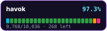</a>
  <a href="https://jaiden051.github.io/gangstar-vegas-decomp/progress.html#mod-glitch" title="glitch: 5,652/6,089 compiling (92.8%) | 40 Clean C++14 | 349 Header Sync | 88 Missing/Stub — Click to inspect">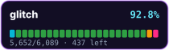</a>
  <a href="https://jaiden051.github.io/gangstar-vegas-decomp/progress.html#mod-gameswf" title="gameswf: 2,372/2,658 compiling (89.2%) | 3 Clean C++14 | 260 Header Sync | 26 Missing/Stub — Click to inspect">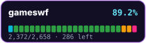</a>
  <a href="https://jaiden051.github.io/gangstar-vegas-decomp/progress.html#mod-vox" title="vox: 1,598/1,689 compiling (94.6%) | 59 Clean C++14 | 79 Header Sync | 12 Missing/Stub — Click to inspect">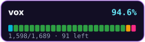</a>
  <a href="https://jaiden051.github.io/gangstar-vegas-decomp/progress.html#mod-glf" title="glf: 1,577/1,608 compiling (98.1%) | 44 Clean C++14 | 13 Header Sync | 18 Missing/Stub — Click to inspect">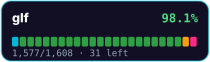</a>
  <a href="https://jaiden051.github.io/gangstar-vegas-decomp/progress.html#mod-openssl" title="openssl: 4,616/4,616 compiling (100.0%) — Click to inspect">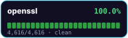</a>
  <a href="https://jaiden051.github.io/gangstar-vegas-decomp/progress.html#mod-boost" title="boost: 1,450/1,464 compiling (99.0%) | 14 Missing/Stub — Click to inspect">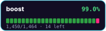</a>
  <a href="https://jaiden051.github.io/gangstar-vegas-decomp/progress.html#mod-gaia" title="gaia: 1,027/1,027 compiling (100.0%) | 2 Clean C++14 — Click to inspect">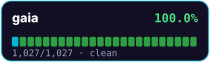</a>
  <a href="https://jaiden051.github.io/gangstar-vegas-decomp/progress.html#mod-grapher" title="Grapher: 3,504/3,510 compiling (99.8%) | 970 Clean C++14 | 6 Missing/Stub — Click to inspect">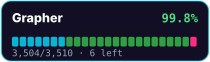</a>
  <a href="https://jaiden051.github.io/gangstar-vegas-decomp/progress.html#mod-core-xmldata" title="Core/XmlData: 1,723/1,723 compiling (100.0%) | 450 Clean C++14 — Click to inspect">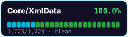</a>
  <a href="https://jaiden051.github.io/gangstar-vegas-decomp/progress.html#mod-physics" title="Physics: 1,638/1,641 compiling (99.8%) | 3 Missing/Stub — Click to inspect">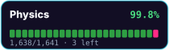</a>
  <a href="https://jaiden051.github.io/gangstar-vegas-decomp/progress.html#mod-ai" title="AI: 1,627/1,627 compiling (100.0%) — Click to inspect">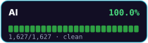</a>
  <a href="https://jaiden051.github.io/gangstar-vegas-decomp/progress.html#mod-rendering" title="Rendering: 1,270/1,270 compiling (100.0%) — Click to inspect">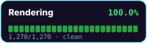</a>
  <a href="https://jaiden051.github.io/gangstar-vegas-decomp/progress.html#mod-menu" title="Menu: 438/561 compiling (78.1%) | 123 Header Sync — Click to inspect">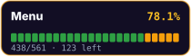</a>
  <a href="https://jaiden051.github.io/gangstar-vegas-decomp/progress.html#mod-jni-bridges" title="JNI Bridges: 919/969 compiling (94.8%) | 291 Clean C++14 | 46 Header Sync | 4 Missing/Stub — Click to inspect">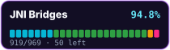</a>
  <a href="https://jaiden051.github.io/gangstar-vegas-decomp/progress.html#mod-libgenerator" title="libgenerator: 1,987/1,987 compiling (100.0%) | 44 Clean C++14 — Click to inspect">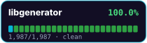</a>
</p>

<div align="center">
  <a href="https://jaiden051.github.io/gangstar-vegas-decomp/progress.html" title="Click to open interactive hoverable &amp; clickable treemap on GitHub Pages">
    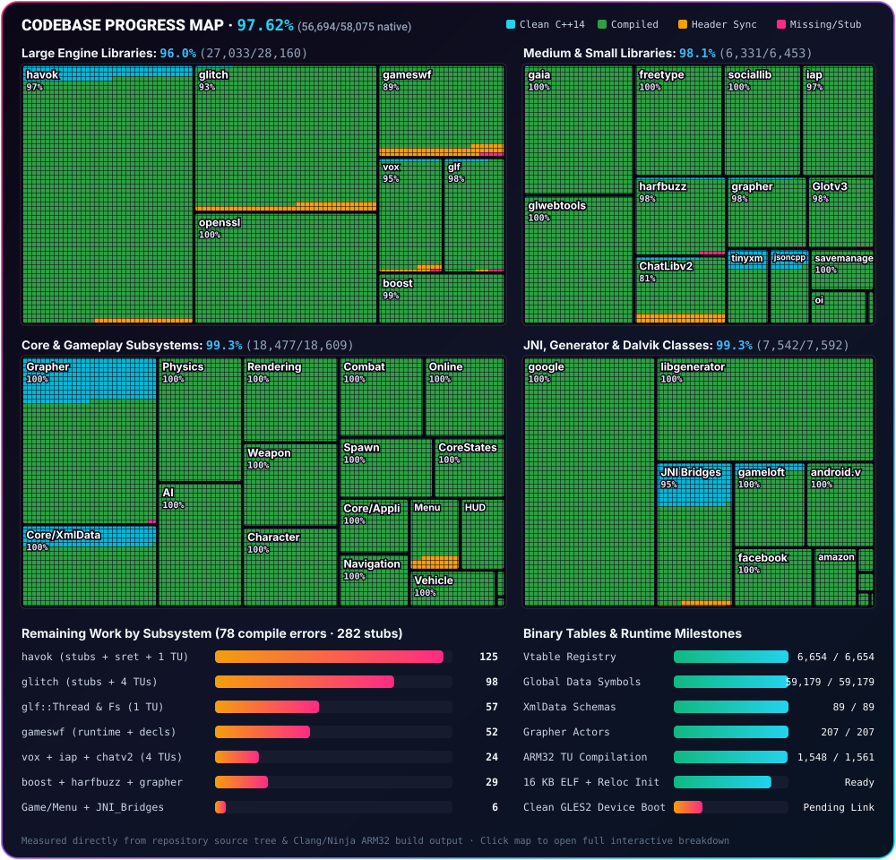
  </a>
</div>

<p align="center">
  <a href="https://jaiden051.github.io/gangstar-vegas-decomp/progress.html"><b>Launch Interactive Treemap &amp; Searchable Report (<code>progress.html</code>)</b></a> · <a href="https://jaiden051.github.io/gangstar-vegas-decomp/progress.json"><code>progress.json</code></a>
</p>

> [!WARNING]
> **Work-in-Progress Build Status** — All C++ translation units now compile for `armeabi-v7a` (NDK r27c, Clang 18), and `libGangstar4.so` / `libgenerator.so` link cleanly with `--no-undefined`, exporting every JNI entry point of the original library. The output has **not** been runtime-tested on a device yet. The module tables and compiler-error table below predate this and still list the 13 TUs that used to fail.

---

## Subsystems Breakdown

<details open>
<summary><b>Engine &amp; Middleware Libraries (<code>G4_UP8Shop/lib/</code> — 21 libraries)</b></summary>
<br/>

<table>
  <thead>
    <tr>
      <th align="left">Module</th>
      <th align="left">Progress</th>
      <th align="right">Compiling</th>
      <th align="right">Total</th>
      <th align="right">%</th>
      <th align="left">Breakdown</th>
    </tr>
  </thead>
  <tbody>
    <tr><td><a href="https://jaiden051.github.io/gangstar-vegas-decomp/progress.html#mod-boost" title="boost: 1,450/1,464 (99.0%)"><code>boost</code></a></td><td><a href="https://jaiden051.github.io/gangstar-vegas-decomp/progress.html#mod-boost" title="boost: 1,450/1,464 (99.0%)"></a></td><td align="right">1,450</td><td align="right">1,464</td><td align="right"><b>99.0%</b></td><td><code>14 stub</code></td></tr>
    <tr><td><a href="https://jaiden051.github.io/gangstar-vegas-decomp/progress.html#mod-chatlibv2" title="ChatLibv2: 363/446 (81.4%)"><code>ChatLibv2</code></a></td><td><a href="https://jaiden051.github.io/gangstar-vegas-decomp/progress.html#mod-chatlibv2" title="ChatLibv2: 363/446 (81.4%)"></a></td><td align="right">363</td><td align="right">446</td><td align="right"><b>81.4%</b></td><td><code>20 C++14</code> · <code>79 sync</code> · <code>4 stub</code></td></tr>
    <tr><td><a href="https://jaiden051.github.io/gangstar-vegas-decomp/progress.html#mod-freetype" title="freetype: 702/702 (100.0%)"><code>freetype</code></a></td><td><a href="https://jaiden051.github.io/gangstar-vegas-decomp/progress.html#mod-freetype" title="freetype: 702/702 (100.0%)"></a></td><td align="right">702</td><td align="right">702</td><td align="right"><b>100.0%</b></td><td><sub>Clean compile</sub></td></tr>
    <tr><td><a href="https://jaiden051.github.io/gangstar-vegas-decomp/progress.html#mod-gaia" title="gaia: 1,027/1,027 (100.0%)"><code>gaia</code></a></td><td><a href="https://jaiden051.github.io/gangstar-vegas-decomp/progress.html#mod-gaia" title="gaia: 1,027/1,027 (100.0%)"></a></td><td align="right">1,027</td><td align="right">1,027</td><td align="right"><b>100.0%</b></td><td><code>2 C++14</code></td></tr>
    <tr><td><a href="https://jaiden051.github.io/gangstar-vegas-decomp/progress.html#mod-gameswf" title="gameswf: 2,372/2,658 (89.2%)"><code>gameswf</code></a></td><td><a href="https://jaiden051.github.io/gangstar-vegas-decomp/progress.html#mod-gameswf" title="gameswf: 2,372/2,658 (89.2%)"></a></td><td align="right">2,372</td><td align="right">2,658</td><td align="right"><b>89.2%</b></td><td><code>3 C++14</code> · <code>260 sync</code> · <code>26 stub</code></td></tr>
    <tr><td><a href="https://jaiden051.github.io/gangstar-vegas-decomp/progress.html#mod-glf" title="glf: 1,577/1,608 (98.1%)"><code>glf</code></a></td><td><a href="https://jaiden051.github.io/gangstar-vegas-decomp/progress.html#mod-glf" title="glf: 1,577/1,608 (98.1%)"></a></td><td align="right">1,577</td><td align="right">1,608</td><td align="right"><b>98.1%</b></td><td><code>44 C++14</code> · <code>13 sync</code> · <code>18 stub</code></td></tr>
    <tr><td><a href="https://jaiden051.github.io/gangstar-vegas-decomp/progress.html#mod-glitch" title="glitch: 5,652/6,089 (92.8%)"><code>glitch</code></a></td><td><a href="https://jaiden051.github.io/gangstar-vegas-decomp/progress.html#mod-glitch" title="glitch: 5,652/6,089 (92.8%)"></a></td><td align="right">5,652</td><td align="right">6,089</td><td align="right"><b>92.8%</b></td><td><code>40 C++14</code> · <code>349 sync</code> · <code>88 stub</code></td></tr>
    <tr><td><a href="https://jaiden051.github.io/gangstar-vegas-decomp/progress.html#mod-glotv3" title="Glotv3: 338/344 (98.3%)"><code>Glotv3</code></a></td><td><a href="https://jaiden051.github.io/gangstar-vegas-decomp/progress.html#mod-glotv3" title="Glotv3: 338/344 (98.3%)"></a></td><td align="right">338</td><td align="right">344</td><td align="right"><b>98.3%</b></td><td><code>2 C++14</code> · <code>6 stub</code></td></tr>
    <tr><td><a href="https://jaiden051.github.io/gangstar-vegas-decomp/progress.html#mod-glwebtools" title="glwebtools: 1,013/1,013 (100.0%)"><code>glwebtools</code></a></td><td><a href="https://jaiden051.github.io/gangstar-vegas-decomp/progress.html#mod-glwebtools" title="glwebtools: 1,013/1,013 (100.0%)"></a></td><td align="right">1,013</td><td align="right">1,013</td><td align="right"><b>100.0%</b></td><td><code>6 C++14</code></td></tr>
    <tr><td><a href="https://jaiden051.github.io/gangstar-vegas-decomp/progress.html#mod-grapher" title="grapher: 408/415 (98.3%)"><code>grapher</code></a></td><td><a href="https://jaiden051.github.io/gangstar-vegas-decomp/progress.html#mod-grapher" title="grapher: 408/415 (98.3%)"></a></td><td align="right">408</td><td align="right">415</td><td align="right"><b>98.3%</b></td><td><code>19 C++14</code> · <code>7 stub</code></td></tr>
    <tr><td><a href="https://jaiden051.github.io/gangstar-vegas-decomp/progress.html#mod-harfbuzz" title="harfbuzz: 512/520 (98.5%)"><code>harfbuzz</code></a></td><td><a href="https://jaiden051.github.io/gangstar-vegas-decomp/progress.html#mod-harfbuzz" title="harfbuzz: 512/520 (98.5%)"></a></td><td align="right">512</td><td align="right">520</td><td align="right"><b>98.5%</b></td><td><code>29 C++14</code> · <code>8 stub</code></td></tr>
    <tr><td><a href="https://jaiden051.github.io/gangstar-vegas-decomp/progress.html#mod-havok" title="havok: 9,768/10,036 (97.3%)"><code>havok</code></a></td><td><a href="https://jaiden051.github.io/gangstar-vegas-decomp/progress.html#mod-havok" title="havok: 9,768/10,036 (97.3%)"></a></td><td align="right">9,768</td><td align="right">10,036</td><td align="right"><b>97.3%</b></td><td><code>597 C++14</code> · <code>173 sync</code> · <code>95 stub</code></td></tr>
    <tr><td><a href="https://jaiden051.github.io/gangstar-vegas-decomp/progress.html#mod-iap" title="iap: 558/576 (96.9%)"><code>iap</code></a></td><td><a href="https://jaiden051.github.io/gangstar-vegas-decomp/progress.html#mod-iap" title="iap: 558/576 (96.9%)"></a></td><td align="right">558</td><td align="right">576</td><td align="right"><b>96.9%</b></td><td><code>14 sync</code> · <code>4 stub</code></td></tr>
    <tr><td><a href="https://jaiden051.github.io/gangstar-vegas-decomp/progress.html#mod-jsoncpp" title="jsoncpp: 219/219 (100.0%)"><code>jsoncpp</code></a></td><td><a href="https://jaiden051.github.io/gangstar-vegas-decomp/progress.html#mod-jsoncpp" title="jsoncpp: 219/219 (100.0%)"></a></td><td align="right">219</td><td align="right">219</td><td align="right"><b>100.0%</b></td><td><code>58 C++14</code></td></tr>
    <tr><td><a href="https://jaiden051.github.io/gangstar-vegas-decomp/progress.html#mod-oi" title="oi: 136/136 (100.0%)"><code>oi</code></a></td><td><a href="https://jaiden051.github.io/gangstar-vegas-decomp/progress.html#mod-oi" title="oi: 136/136 (100.0%)"></a></td><td align="right">136</td><td align="right">136</td><td align="right"><b>100.0%</b></td><td><sub>Clean compile</sub></td></tr>
    <tr><td><a href="https://jaiden051.github.io/gangstar-vegas-decomp/progress.html#mod-openssl" title="openssl: 4,616/4,616 (100.0%)"><code>openssl</code></a></td><td><a href="https://jaiden051.github.io/gangstar-vegas-decomp/progress.html#mod-openssl" title="openssl: 4,616/4,616 (100.0%)"></a></td><td align="right">4,616</td><td align="right">4,616</td><td align="right"><b>100.0%</b></td><td><sub>Clean compile</sub></td></tr>
    <tr><td><a href="https://jaiden051.github.io/gangstar-vegas-decomp/progress.html#mod-popuplib" title="popuplib: 17/17 (100.0%)"><code>popuplib</code></a></td><td><a href="https://jaiden051.github.io/gangstar-vegas-decomp/progress.html#mod-popuplib" title="popuplib: 17/17 (100.0%)"></a></td><td align="right">17</td><td align="right">17</td><td align="right"><b>100.0%</b></td><td><sub>Clean compile</sub></td></tr>
    <tr><td><a href="https://jaiden051.github.io/gangstar-vegas-decomp/progress.html#mod-savemanager" title="savemanager: 191/191 (100.0%)"><code>savemanager</code></a></td><td><a href="https://jaiden051.github.io/gangstar-vegas-decomp/progress.html#mod-savemanager" title="savemanager: 191/191 (100.0%)"></a></td><td align="right">191</td><td align="right">191</td><td align="right"><b>100.0%</b></td><td><sub>Clean compile</sub></td></tr>
    <tr><td><a href="https://jaiden051.github.io/gangstar-vegas-decomp/progress.html#mod-sociallib" title="sociallib: 620/620 (100.0%)"><code>sociallib</code></a></td><td><a href="https://jaiden051.github.io/gangstar-vegas-decomp/progress.html#mod-sociallib" title="sociallib: 620/620 (100.0%)"></a></td><td align="right">620</td><td align="right">620</td><td align="right"><b>100.0%</b></td><td><sub>Clean compile</sub></td></tr>
    <tr><td><a href="https://jaiden051.github.io/gangstar-vegas-decomp/progress.html#mod-tinyxml" title="tinyxml: 227/227 (100.0%)"><code>tinyxml</code></a></td><td><a href="https://jaiden051.github.io/gangstar-vegas-decomp/progress.html#mod-tinyxml" title="tinyxml: 227/227 (100.0%)"></a></td><td align="right">227</td><td align="right">227</td><td align="right"><b>100.0%</b></td><td><code>62 C++14</code></td></tr>
    <tr><td><a href="https://jaiden051.github.io/gangstar-vegas-decomp/progress.html#mod-vox" title="vox: 1,598/1,689 (94.6%)"><code>vox</code></a></td><td><a href="https://jaiden051.github.io/gangstar-vegas-decomp/progress.html#mod-vox" title="vox: 1,598/1,689 (94.6%)"></a></td><td align="right">1,598</td><td align="right">1,689</td><td align="right"><b>94.6%</b></td><td><code>59 C++14</code> · <code>79 sync</code> · <code>12 stub</code></td></tr>
  </tbody>
</table>

</details>

<details>
<summary><b>Core &amp; Gameplay Subsystems (<code>G4_UP8Shop/sources/</code> — 18 subsystems)</b></summary>
<br/>

<table>
  <thead>
    <tr>
      <th align="left">Module</th>
      <th align="left">Progress</th>
      <th align="right">Compiling</th>
      <th align="right">Total</th>
      <th align="right">%</th>
      <th align="left">Breakdown</th>
    </tr>
  </thead>
  <tbody>
    <tr><td><a href="https://jaiden051.github.io/gangstar-vegas-decomp/progress.html#mod-ai" title="AI: 1,627/1,627 (100.0%)"><code>AI</code></a></td><td><a href="https://jaiden051.github.io/gangstar-vegas-decomp/progress.html#mod-ai" title="AI: 1,627/1,627 (100.0%)"></a></td><td align="right">1,627</td><td align="right">1,627</td><td align="right"><b>100.0%</b></td><td><sub>Clean compile</sub></td></tr>
    <tr><td><a href="https://jaiden051.github.io/gangstar-vegas-decomp/progress.html#mod-animation" title="Animation: 15/15 (100.0%)"><code>Animation</code></a></td><td><a href="https://jaiden051.github.io/gangstar-vegas-decomp/progress.html#mod-animation" title="Animation: 15/15 (100.0%)"></a></td><td align="right">15</td><td align="right">15</td><td align="right"><b>100.0%</b></td><td><sub>Clean compile</sub></td></tr>
    <tr><td><a href="https://jaiden051.github.io/gangstar-vegas-decomp/progress.html#mod-character" title="Character: 1,185/1,185 (100.0%)"><code>Character</code></a></td><td><a href="https://jaiden051.github.io/gangstar-vegas-decomp/progress.html#mod-character" title="Character: 1,185/1,185 (100.0%)"></a></td><td align="right">1,185</td><td align="right">1,185</td><td align="right"><b>100.0%</b></td><td><sub>Clean compile</sub></td></tr>
    <tr><td><a href="https://jaiden051.github.io/gangstar-vegas-decomp/progress.html#mod-combat" title="Combat: 1,056/1,056 (100.0%)"><code>Combat</code></a></td><td><a href="https://jaiden051.github.io/gangstar-vegas-decomp/progress.html#mod-combat" title="Combat: 1,056/1,056 (100.0%)"></a></td><td align="right">1,056</td><td align="right">1,056</td><td align="right"><b>100.0%</b></td><td><sub>Clean compile</sub></td></tr>
    <tr><td><a href="https://jaiden051.github.io/gangstar-vegas-decomp/progress.html#mod-core-application" title="Core/Application: 601/601 (100.0%)"><code>Core/Application</code></a></td><td><a href="https://jaiden051.github.io/gangstar-vegas-decomp/progress.html#mod-core-application" title="Core/Application: 601/601 (100.0%)"></a></td><td align="right">601</td><td align="right">601</td><td align="right"><b>100.0%</b></td><td><sub>Clean compile</sub></td></tr>
    <tr><td><a href="https://jaiden051.github.io/gangstar-vegas-decomp/progress.html#mod-core-memory" title="Core/Memory: 38/38 (100.0%)"><code>Core/Memory</code></a></td><td><a href="https://jaiden051.github.io/gangstar-vegas-decomp/progress.html#mod-core-memory" title="Core/Memory: 38/38 (100.0%)"></a></td><td align="right">38</td><td align="right">38</td><td align="right"><b>100.0%</b></td><td><sub>Clean compile</sub></td></tr>
    <tr><td><a href="https://jaiden051.github.io/gangstar-vegas-decomp/progress.html#mod-core-xmldata" title="Core/XmlData: 1,723/1,723 (100.0%)"><code>Core/XmlData</code></a></td><td><a href="https://jaiden051.github.io/gangstar-vegas-decomp/progress.html#mod-core-xmldata" title="Core/XmlData: 1,723/1,723 (100.0%)"></a></td><td align="right">1,723</td><td align="right">1,723</td><td align="right"><b>100.0%</b></td><td><code>450 C++14</code></td></tr>
    <tr><td><a href="https://jaiden051.github.io/gangstar-vegas-decomp/progress.html#mod-corestates" title="CoreStates: 671/671 (100.0%)"><code>CoreStates</code></a></td><td><a href="https://jaiden051.github.io/gangstar-vegas-decomp/progress.html#mod-corestates" title="CoreStates: 671/671 (100.0%)"></a></td><td align="right">671</td><td align="right">671</td><td align="right"><b>100.0%</b></td><td><sub>Clean compile</sub></td></tr>
    <tr><td><a href="https://jaiden051.github.io/gangstar-vegas-decomp/progress.html#mod-grapher" title="Grapher: 3,504/3,510 (99.8%)"><code>Grapher</code></a></td><td><a href="https://jaiden051.github.io/gangstar-vegas-decomp/progress.html#mod-grapher" title="Grapher: 3,504/3,510 (99.8%)"></a></td><td align="right">3,504</td><td align="right">3,510</td><td align="right"><b>99.8%</b></td><td><code>970 C++14</code> · <code>6 stub</code></td></tr>
    <tr><td><a href="https://jaiden051.github.io/gangstar-vegas-decomp/progress.html#mod-hud" title="HUD: 500/500 (100.0%)"><code>HUD</code></a></td><td><a href="https://jaiden051.github.io/gangstar-vegas-decomp/progress.html#mod-hud" title="HUD: 500/500 (100.0%)"></a></td><td align="right">500</td><td align="right">500</td><td align="right"><b>100.0%</b></td><td><sub>Clean compile</sub></td></tr>
    <tr><td><a href="https://jaiden051.github.io/gangstar-vegas-decomp/progress.html#mod-menu" title="Menu: 438/561 (78.1%)"><code>Menu</code></a></td><td><a href="https://jaiden051.github.io/gangstar-vegas-decomp/progress.html#mod-menu" title="Menu: 438/561 (78.1%)"></a></td><td align="right">438</td><td align="right">561</td><td align="right"><b>78.1%</b></td><td><code>123 sync</code></td></tr>
    <tr><td><a href="https://jaiden051.github.io/gangstar-vegas-decomp/progress.html#mod-navigation" title="Navigation: 581/581 (100.0%)"><code>Navigation</code></a></td><td><a href="https://jaiden051.github.io/gangstar-vegas-decomp/progress.html#mod-navigation" title="Navigation: 581/581 (100.0%)"></a></td><td align="right">581</td><td align="right">581</td><td align="right"><b>100.0%</b></td><td><sub>Clean compile</sub></td></tr>
    <tr><td><a href="https://jaiden051.github.io/gangstar-vegas-decomp/progress.html#mod-online" title="Online: 1,007/1,007 (100.0%)"><code>Online</code></a></td><td><a href="https://jaiden051.github.io/gangstar-vegas-decomp/progress.html#mod-online" title="Online: 1,007/1,007 (100.0%)"></a></td><td align="right">1,007</td><td align="right">1,007</td><td align="right"><b>100.0%</b></td><td><sub>Clean compile</sub></td></tr>
    <tr><td><a href="https://jaiden051.github.io/gangstar-vegas-decomp/progress.html#mod-physics" title="Physics: 1,638/1,641 (99.8%)"><code>Physics</code></a></td><td><a href="https://jaiden051.github.io/gangstar-vegas-decomp/progress.html#mod-physics" title="Physics: 1,638/1,641 (99.8%)"></a></td><td align="right">1,638</td><td align="right">1,641</td><td align="right"><b>99.8%</b></td><td><code>3 stub</code></td></tr>
    <tr><td><a href="https://jaiden051.github.io/gangstar-vegas-decomp/progress.html#mod-rendering" title="Rendering: 1,270/1,270 (100.0%)"><code>Rendering</code></a></td><td><a href="https://jaiden051.github.io/gangstar-vegas-decomp/progress.html#mod-rendering" title="Rendering: 1,270/1,270 (100.0%)"></a></td><td align="right">1,270</td><td align="right">1,270</td><td align="right"><b>100.0%</b></td><td><sub>Clean compile</sub></td></tr>
    <tr><td><a href="https://jaiden051.github.io/gangstar-vegas-decomp/progress.html#mod-spawn" title="Spawn: 886/886 (100.0%)"><code>Spawn</code></a></td><td><a href="https://jaiden051.github.io/gangstar-vegas-decomp/progress.html#mod-spawn" title="Spawn: 886/886 (100.0%)"></a></td><td align="right">886</td><td align="right">886</td><td align="right"><b>100.0%</b></td><td><sub>Clean compile</sub></td></tr>
    <tr><td><a href="https://jaiden051.github.io/gangstar-vegas-decomp/progress.html#mod-vehicle" title="Vehicle: 494/494 (100.0%)"><code>Vehicle</code></a></td><td><a href="https://jaiden051.github.io/gangstar-vegas-decomp/progress.html#mod-vehicle" title="Vehicle: 494/494 (100.0%)"></a></td><td align="right">494</td><td align="right">494</td><td align="right"><b>100.0%</b></td><td><sub>Clean compile</sub></td></tr>
    <tr><td><a href="https://jaiden051.github.io/gangstar-vegas-decomp/progress.html#mod-weapon" title="Weapon: 1,243/1,243 (100.0%)"><code>Weapon</code></a></td><td><a href="https://jaiden051.github.io/gangstar-vegas-decomp/progress.html#mod-weapon" title="Weapon: 1,243/1,243 (100.0%)"></a></td><td align="right">1,243</td><td align="right">1,243</td><td align="right"><b>100.0%</b></td><td><sub>Clean compile</sub></td></tr>
  </tbody>
</table>

</details>

<details>
<summary><b>Android JNI, Generator &amp; Dalvik Packages (<code>4,634</code> classes + JNI)</b></summary>
<br/>

<table>
  <thead>
    <tr>
      <th align="left">Module</th>
      <th align="left">Progress</th>
      <th align="right">Compiling</th>
      <th align="right">Total</th>
      <th align="right">%</th>
      <th align="left">Breakdown</th>
    </tr>
  </thead>
  <tbody>
    <tr><td><a href="https://jaiden051.github.io/gangstar-vegas-decomp/progress.html#mod-dex-amazon" title="dex:amazon: 226/226 (100.0%)"><code>dex:amazon</code></a></td><td><a href="https://jaiden051.github.io/gangstar-vegas-decomp/progress.html#mod-dex-amazon" title="dex:amazon: 226/226 (100.0%)"></a></td><td align="right">226</td><td align="right">226</td><td align="right"><b>100.0%</b></td><td><sub>Clean compile</sub></td></tr>
    <tr><td><a href="https://jaiden051.github.io/gangstar-vegas-decomp/progress.html#mod-dex-android-v4" title="dex:android.v4: 506/506 (100.0%)"><code>dex:android.v4</code></a></td><td><a href="https://jaiden051.github.io/gangstar-vegas-decomp/progress.html#mod-dex-android-v4" title="dex:android.v4: 506/506 (100.0%)"></a></td><td align="right">506</td><td align="right">506</td><td align="right"><b>100.0%</b></td><td><sub>Clean compile</sub></td></tr>
    <tr><td><a href="https://jaiden051.github.io/gangstar-vegas-decomp/progress.html#mod-dex-bda" title="dex:bda: 29/29 (100.0%)"><code>dex:bda</code></a></td><td><a href="https://jaiden051.github.io/gangstar-vegas-decomp/progress.html#mod-dex-bda" title="dex:bda: 29/29 (100.0%)"></a></td><td align="right">29</td><td align="right">29</td><td align="right"><b>100.0%</b></td><td><sub>Clean compile</sub></td></tr>
    <tr><td><a href="https://jaiden051.github.io/gangstar-vegas-decomp/progress.html#mod-dex-facebook" title="dex:facebook: 413/413 (100.0%)"><code>dex:facebook</code></a></td><td><a href="https://jaiden051.github.io/gangstar-vegas-decomp/progress.html#mod-dex-facebook" title="dex:facebook: 413/413 (100.0%)"></a></td><td align="right">413</td><td align="right">413</td><td align="right"><b>100.0%</b></td><td><sub>Clean compile</sub></td></tr>
    <tr><td><a href="https://jaiden051.github.io/gangstar-vegas-decomp/progress.html#mod-dex-gameloft" title="dex:gameloft: 536/536 (100.0%)"><code>dex:gameloft</code></a></td><td><a href="https://jaiden051.github.io/gangstar-vegas-decomp/progress.html#mod-dex-gameloft" title="dex:gameloft: 536/536 (100.0%)"></a></td><td align="right">536</td><td align="right">536</td><td align="right"><b>100.0%</b></td><td><code>64 C++14</code></td></tr>
    <tr><td><a href="https://jaiden051.github.io/gangstar-vegas-decomp/progress.html#mod-dex-google" title="dex:google: 2,866/2,866 (100.0%)"><code>dex:google</code></a></td><td><a href="https://jaiden051.github.io/gangstar-vegas-decomp/progress.html#mod-dex-google" title="dex:google: 2,866/2,866 (100.0%)"></a></td><td align="right">2,866</td><td align="right">2,866</td><td align="right"><b>100.0%</b></td><td><sub>Clean compile</sub></td></tr>
    <tr><td><a href="https://jaiden051.github.io/gangstar-vegas-decomp/progress.html#mod-dex-loopj" title="dex:loopj: 17/17 (100.0%)"><code>dex:loopj</code></a></td><td><a href="https://jaiden051.github.io/gangstar-vegas-decomp/progress.html#mod-dex-loopj" title="dex:loopj: 17/17 (100.0%)"></a></td><td align="right">17</td><td align="right">17</td><td align="right"><b>100.0%</b></td><td><sub>Clean compile</sub></td></tr>
    <tr><td><a href="https://jaiden051.github.io/gangstar-vegas-decomp/progress.html#mod-dex-misc" title="dex:misc: 37/37 (100.0%)"><code>dex:misc</code></a></td><td><a href="https://jaiden051.github.io/gangstar-vegas-decomp/progress.html#mod-dex-misc" title="dex:misc: 37/37 (100.0%)"></a></td><td align="right">37</td><td align="right">37</td><td align="right"><b>100.0%</b></td><td><sub>Clean compile</sub></td></tr>
    <tr><td><a href="https://jaiden051.github.io/gangstar-vegas-decomp/progress.html#mod-dex-sec" title="dex:sec: 6/6 (100.0%)"><code>dex:sec</code></a></td><td><a href="https://jaiden051.github.io/gangstar-vegas-decomp/progress.html#mod-dex-sec" title="dex:sec: 6/6 (100.0%)"></a></td><td align="right">6</td><td align="right">6</td><td align="right"><b>100.0%</b></td><td><sub>Clean compile</sub></td></tr>
    <tr><td><a href="https://jaiden051.github.io/gangstar-vegas-decomp/progress.html#mod-jni-bridges" title="JNI Bridges: 919/969 (94.8%)"><code>JNI Bridges</code></a></td><td><a href="https://jaiden051.github.io/gangstar-vegas-decomp/progress.html#mod-jni-bridges" title="JNI Bridges: 919/969 (94.8%)"></a></td><td align="right">919</td><td align="right">969</td><td align="right"><b>94.8%</b></td><td><code>291 C++14</code> · <code>46 sync</code> · <code>4 stub</code></td></tr>
    <tr><td><a href="https://jaiden051.github.io/gangstar-vegas-decomp/progress.html#mod-libgenerator" title="libgenerator: 1,987/1,987 (100.0%)"><code>libgenerator</code></a></td><td><a href="https://jaiden051.github.io/gangstar-vegas-decomp/progress.html#mod-libgenerator" title="libgenerator: 1,987/1,987 (100.0%)"></a></td><td align="right">1,987</td><td align="right">1,987</td><td align="right"><b>100.0%</b></td><td><code>44 C++14</code></td></tr>
  </tbody>
</table>

</details>

<details>
<summary><b>Compiler Errors by Failing Translation Unit (<code>78</code> total across <code>13</code> TUs)</b></summary>
<br/>

<table>
  <thead><tr><th align="left">Failing Translation Unit</th><th align="left">Share</th><th align="right">Errors</th></tr></thead>
  <tbody>
    <tr><td><a href="https://jaiden051.github.io/gangstar-vegas-decomp/progress.html#mod-glf"><code>glf_ThreadMgr.cpp</code></a></td><td></td><td align="right"><b>39</b></td></tr>
    <tr><td><a href="https://jaiden051.github.io/gangstar-vegas-decomp/progress.html#mod-gameswf"><code>gameswf_runtime.cpp</code></a></td><td></td><td align="right"><b>26</b></td></tr>
    <tr><td><a href="https://jaiden051.github.io/gangstar-vegas-decomp/progress.html#mod-glitch"><code>glitch_scene_part02.cpp</code></a></td><td></td><td align="right"><b>2</b></td></tr>
    <tr><td><a href="https://jaiden051.github.io/gangstar-vegas-decomp/progress.html#mod-chatlibv2"><code>chatv2_Connectivity.cpp</code></a></td><td></td><td align="right"><b>2</b></td></tr>
    <tr><td><a href="https://jaiden051.github.io/gangstar-vegas-decomp/progress.html#mod-menu"><code>TU32_MenuControllerPart12.cpp</code></a></td><td></td><td align="right"><b>1</b></td></tr>
    <tr><td><a href="https://jaiden051.github.io/gangstar-vegas-decomp/progress.html#mod-glitch"><code>glitch_IDevice.cpp</code></a></td><td></td><td align="right"><b>1</b></td></tr>
    <tr><td><a href="https://jaiden051.github.io/gangstar-vegas-decomp/progress.html#mod-glitch"><code>glitch_collada_part02.cpp</code></a></td><td></td><td align="right"><b>1</b></td></tr>
    <tr><td><a href="https://jaiden051.github.io/gangstar-vegas-decomp/progress.html#mod-glitch"><code>glitch_collada_part03.cpp</code></a></td><td></td><td align="right"><b>1</b></td></tr>
    <tr><td><a href="https://jaiden051.github.io/gangstar-vegas-decomp/progress.html#mod-havok"><code>havok_internal_0.cpp</code></a></td><td></td><td align="right"><b>1</b></td></tr>
    <tr><td><a href="https://jaiden051.github.io/gangstar-vegas-decomp/progress.html#mod-iap"><code>iap_Command.cpp</code></a></td><td></td><td align="right"><b>1</b></td></tr>
    <tr><td><a href="https://jaiden051.github.io/gangstar-vegas-decomp/progress.html#mod-vox"><code>vox_VoxArchive.cpp</code></a></td><td></td><td align="right"><b>1</b></td></tr>
    <tr><td><a href="https://jaiden051.github.io/gangstar-vegas-decomp/progress.html#mod-vox"><code>vox_vs.cpp</code></a></td><td></td><td align="right"><b>1</b></td></tr>
    <tr><td><a href="https://jaiden051.github.io/gangstar-vegas-decomp/progress.html#mod-jni-bridges"><code>JNI_ExternalBridges.cpp</code></a></td><td></td><td align="right"><b>1</b></td></tr>
  </tbody>
</table>

</details>

---

## Repository Layout

```text
╭── CMakeLists.txt                     # CMake + Ninja build config (Gangstar4Core, Gangstar4, generator)
├── ARCHITECTURE.md                    # Full binary segment map, TU table, XmlData & Actor index
├── docs/                              # Interactive progress explorer (progress.html, progress.svg, progress.json)
├── G4_UP8Shop/
│   ├── sources/
│   │   ├── Core/                      # Allocator, VtableRegistry, GlobalSymbols, 89 XmlData schemas
│   │   └── Game/                      # TU01..TU41 gameplay modules + 207 Grapher visual-script actors
│   ├── lib/                           # 20 decompiled engines & libs (glf, glitch, havok, gameswf, vox...)
│   └── androidPort/GameSpecific/      # Android JNI bridges & 4,634 decompiled Java classes
╰── GLLegacy_HDIDFV/                   # Companion libgenerator.so C++14 implementation
```

---

## Assets &amp; Binaries

> [!IMPORTANT]
> **Bring Your Own Game Files** — Zero proprietary Gameloft assets, APKs, OBBs, UI resources, shaders, audio, or raw `.rodata`/`.data` binary blobs are stored in this repository. You must extract required runtime assets and binary sections from your own legally obtained copy of Gangstar Vegas v1.8.2f.

---

## Building (armeabi-v7a)

The decompiled sources address the original game's data by its virtual address in the **x86** build of `libGangstar4.so` (`.rodata` at `0x1b14c40`, RW segment at `0x20307e0`), even though the target is ARM32. `GlobalSymbols.cpp` `.incbin`s those two regions, so extract them first from your own APK:

```sh
# 1. Pull the x86 library out of your APK and extract the data blobs
unzip -j Gangstar_Vegas_v1.8.2f.apk lib/x86/libGangstar4.so -d bin/x86
python tools/extract_data_blobs.py bin/x86/libGangstar4.so
#    -> G4_UP8Shop/sources/Core/Data/g4_rodata_image.bin, g4_rwdata_init.bin (git-ignored)

# 2. Configure and build with the Android NDK (tested with r27c)
cmake -S . -B build-armv7 -G Ninja \
  -DCMAKE_TOOLCHAIN_FILE=$ANDROID_NDK/build/cmake/android.toolchain.cmake \
  -DANDROID_ABI=armeabi-v7a -DANDROID_PLATFORM=android-21 -DCMAKE_BUILD_TYPE=Release
cmake --build build-armv7
```

Outputs: `build-armv7/libGangstar4.so` and `build-armv7/libgenerator.so`.

Lines tagged `// G4_PTR32` narrow a pointer to `int`. They are correct on the 32-bit target and are known breakage points for a future 64-bit port.
