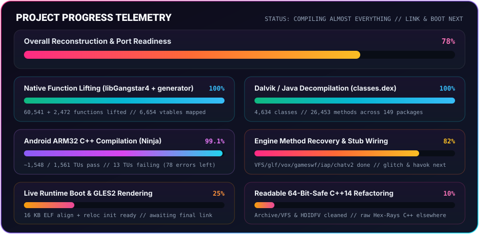

<div align="center">


<br/>


-00e5ff?style=for-the-badge&labelColor=120b24)


</div>

---

<div align="center">
  
</div>

<br/>

> [!WARNING]
> **Work-in-Progress Build Status** — This repo does **not** compile into a finished binary out of the box yet. Roughly **99.1%** of C++ translation units compile cleanly under Clang/Ninja, with **13 translation units (78 compiler errors)** left to wire up across forward declarations and recovered middleware methods.

---

## Subsystem Matrix

<table>
  <thead>
    <tr>
      <th align="left">Layer</th>
      <th align="left">Scope</th>
      <th align="left">Progress</th>
      <th align="left">Current State</th>
    </tr>
  </thead>
  <tbody>
    <tr>
      <td><b><code>sources/Core</code> &amp; <code>Game</code></b></td>
      <td>41 TUs · 89 XmlData · 207 Actors</td>
      <td><code>███████████████████░</code> <b>98%</b></td>
      <td>1 minor pointer-cast mismatch left in <code>TU32</code></td>
    </tr>
    <tr>
      <td><b><code>lib/glf</code> · <code>vox</code> · <code>iap</code> · <code>chatv2</code></b></td>
      <td>VFS, Threads, Audio, Networking</td>
      <td><code>█████████████████░░░</code> <b>88%</b></td>
      <td>Bodies implemented; awaiting header prototype sync</td>
    </tr>
    <tr>
      <td><b><code>lib/gameswf</code></b></td>
      <td>Flash UI &amp; ActionScript 2.0 VM</td>
      <td><code>████████████████░░░░</code> <b>82%</b></td>
      <td>22 runtime methods added; header declarations pending</td>
    </tr>
    <tr>
      <td><b><code>lib/glitch</code> &amp; <code>lib/havok</code></b></td>
      <td>3D Renderer &amp; Physics Engine</td>
      <td><code>██████████████░░░░░░</code> <b>72%</b></td>
      <td>Remaining missing methods &amp; <code>sret</code> call sites queued</td>
    </tr>
    <tr>
      <td><b><code>androidPort</code> &amp; <code>HDIDFV</code></b></td>
      <td>760 JNI funcs · 4,634 Java classes</td>
      <td><code>███████████████████░</code> <b>96%</b></td>
      <td>Decompiled; awaiting final <code>libGangstar4.so</code> link</td>
    </tr>
  </tbody>
</table>

---

## Repository Layout

```text
╭── CMakeLists.txt                     # CMake + Ninja build config (Gangstar4Core, Gangstar4, generator)
├── ARCHITECTURE.md                    # Full binary segment map, TU table, XmlData & Actor index
├── G4_UP8Shop/
│   ├── sources/
│   │   ├── Core/                      # Allocator, VtableRegistry, GlobalSymbols, 89 XmlData schemas
│   │   └── Game/                      # TU01..TU41 gameplay modules + 207 Grapher visual-script actors
│   ├── lib/                           # 20 decompiled engines & libs (glf, glitch, havok, gameswf, vox...)
│   └── androidPort/GameSpecific/      # Android JNI bridges & 4,634 decompiled Java classes
╰── GLLegacy_HDIDFV/                   # Companion libgenerator.so C++14 implementation
```

<details>
<summary><b>What's Left on the Roadmap? (Click to expand)</b></summary>
<br/>

- [x] Lift all `60,541` `libGangstar4.so` functions, `2,472` `libgenerator.so` functions, and `4,634` DEX classes
- [x] Reconstruct all `6,654` vtables and `59,179` global symbol definitions
- [x] Overhaul VFS / Zip / Pak archive readers (`glf`, `glitch`, `vox`, `CResFileManager`)
- [ ] Finish wiring `DecompForwardDecls.h` prototypes for `glf::Thread`, `gameswf`, `vox`, `iap`, and `chatv2`
- [ ] Land remaining `glitch` renderer and `havok` physics methods + `sret` caller fixes
- [ ] Link `libGangstar4.so`, verify live GLES2 boot, and refactor raw Hex-Rays output into clean 64-bit-safe C++14

</details>

---

> [!IMPORTANT]
> **Bring Your Own Game Files** — Zero proprietary Gameloft assets, APKs, OBBs, UI resources, shaders, audio, or raw `.rodata`/`.data` binary blobs are stored in this repository. You must extract required runtime assets and binary sections from your own legally obtained copy of Gangstar Vegas v1.8.2f.
